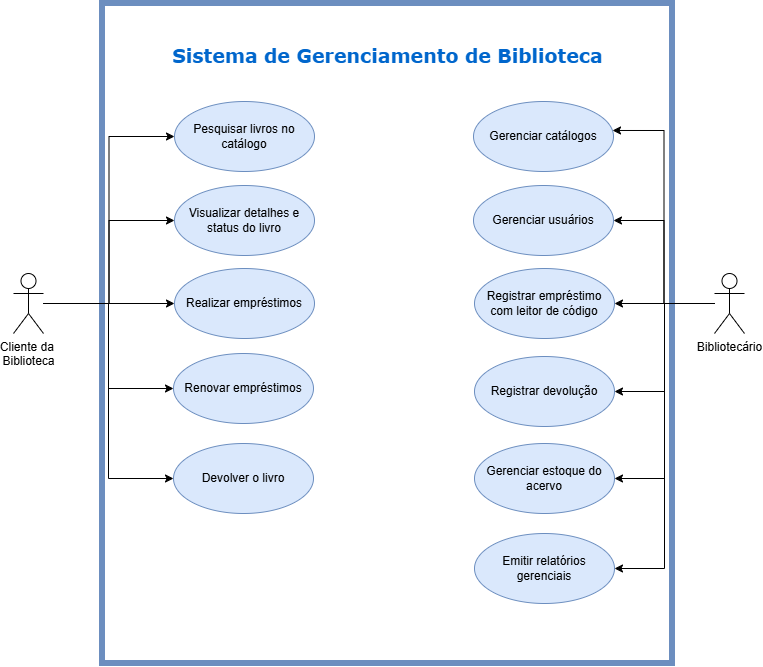
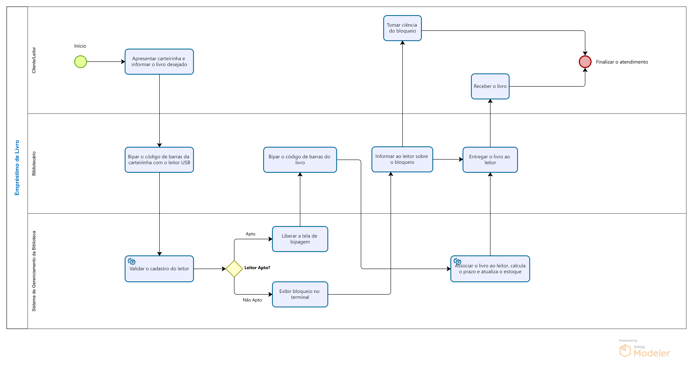

# 🚀 Visão do Produto e Personas

## 1. Declaração do Problema:

| Problema | Afetados | Impacto | Solução |
| :--- | :--- | :--- | :--- |
| Processos manuais e um sistema legado obsoleto | Bibliotecários (funcionários) | Lentidão no atendimento, erros no controle de estoque de livros, perda de prazos de devolução e dificuldades na localização de obras no acervo | Um sistema moderno de gerenciamento que automatize empréstimos/devoluções com código de barras, atualize o estoque em tempo real e forneça métricas operacionais |
| Falta de acesso remoto ao acervo público | Usuários (leitores e frequentadores) | Deslocamentos desnecessários até a biblioteca sem a garantia de disponibilidade da obra desejada | Um catálogo online acessível via web, permitindo consultas prévias por título, autor, categoria e status do livro |

---
## 2. Objetivos do Produto

* **Geral:**
  * Modernizar e automatizar a gestão operacional da Biblioteca sem interromper os atendimentos em andamento.
* **Objetivos Específicos:**
  * Reduzir o tempo de registro de empréstimos e devoluções com leitor de código de barras.
  * Disponibilizar um catálogo online amigável para pesquisa pública de acervo em tempo real.
  * Automatizar alertas e notificações sobre prazos de devolução pendentes e estoque baixo.
  * Gerar relatórios estatísticos para apoiar decisões de compras e reposição de livros.
 
 ### 2.1 Fora do Escopo (Fase 1)
- Venda ou e-commerce de livros físicos/digitais.
- Empréstimo de e-books / acervo digital (DRM).
- Integração com redes de bibliotecas de outros municípios nesta versão inicial.

---

## 3. Mapeamento de Personas

### Persona 1: O Operador do Sistema
* **Nome:** Maria Clara (42 anos)
* **Função:** Bibliotecária Chefe
* **Necessidades:**
  * Agilidade para registrar empréstimos e devoluções no balcão de atendimento.
  * Controle rigoroso sobre quem está com cada livro e datas de vencimento.
  * Relatórios simples para apresentar à gestão municipal sobre os livros mais populares.
* **Dores:**
  * Sistema atual é lento, trava com frequência e exige digitação manual prolongada.
  * Frequentes inconsistências entre a quantidade de livros no sistema e na estante.

---

### Persona 2: O Usuário Final / Leitor
* **Nome:** Lucas Andrade (21 anos)
* **Função:** Estudante Universitário / Frequentador da Biblioteca
* **Necessidades:**
  * Consultar pela internet se um livro específico está disponível antes de ir até a biblioteca.
  * Visualizar a sinopse, foto da capa e detalhes técnicos da obra.
  * Receber lembretes antes do prazo de devolução vencer para evitar bloqueios.
* **Dores:**
  * Perder tempo indo até a biblioteca física para descobrir que o livro desejado já foi emprestado.
  * Esquecer a data de devolução por falta de aviso preventivo e ser bloqueado.

---

## 4. Escopo Visual: Diagrama de Casos de Uso (UML)

O diagrama abaixo sintetiza as interações entre os atores operacionais (Bibliotecário) e finais (Usuários) e os limites do Sistema de Gerenciamento de Biblioteca:

---

## 5. Modelagem de Processos de Negócio (BPMN)
* **Fluxo de Empréstimo:**
O diagrama abaixo ilustra o fluxo operacional de atendimento presencial no balcão da biblioteca, detalhando as interações entre o usuário, bibliotecário e o sistema de gerenciamento da biblioteca durante a validação de regras de empréstimo:

