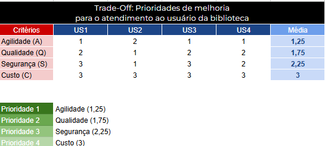

# 📊 Matriz Trade-Off: Priorização de Melhoria de Processos

Este artefato faz parte da análise de processos do **Sistema de Gerenciamento de Biblioteca (SGB)**, aplicando conceitos de priorização com stakeholders para fundamentar o redesenho do fluxo operacional.

## 🎯 Objetivo
Identificar, em conjunto com os usuários/stakeholders, quais dimensões críticas devem receber maior foco na modelagem do processo **TO-BE**, equilibrando expectativas conflitantes (como agilidade *versus* segurança).

## 👥 Stakeholders Avaliados (Usuários - US)
* **US1:** Bibliotecário(a) (Operacional)
* **US2:** Gestor(a) da Biblioteca (Estratégico)
* **US3:** Leitor / Estudante (Cliente final)
* **US4:** Assistente de Atendimento (Suporte)

## 📐 Critérios e Escala
* **Escala:** 1 (Mais importante) a 3 (Menos importante). 
* **Regra de Decisão:** Menor média = Maior prioridade estratégica.

## 📈 Resultado da Matriz

### Ranking de Prioridades:
1. **Agilidade (Média: 1,25)** - Foco principal na redução do tempo de espera do leitor no balcão.
2. **Qualidade (Média: 1,75)** - Garantia de assertividade nos cadastros e dados dos livros.
3. **Segurança (Média: 2,25)** - Controle de inadimplência e perdas.
4. **Custo (Média: 3,00)** - Menor peso relativo para este escopo inicial.

---
**Próximo Passo:** Utilizar esta prioridade para o mapeamento e modelagem do fluxo **AS-IS** e posterior proposta **TO-BE** em BPMN.
