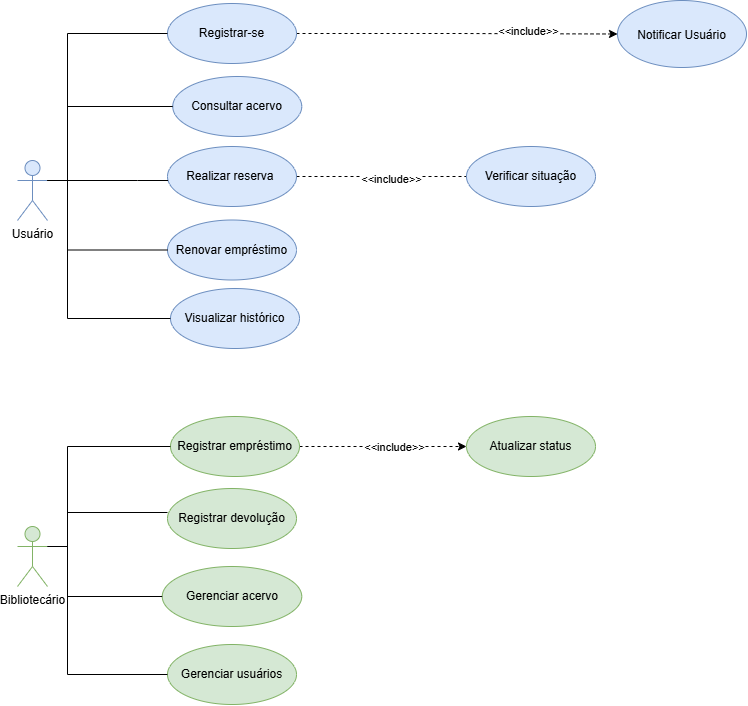
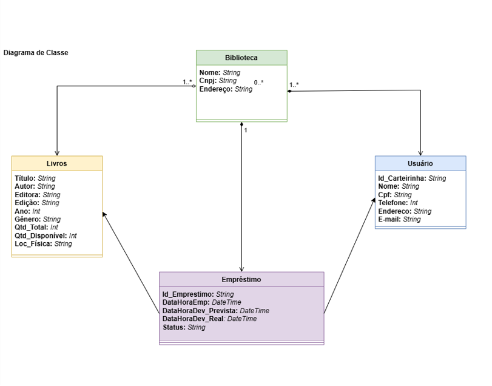
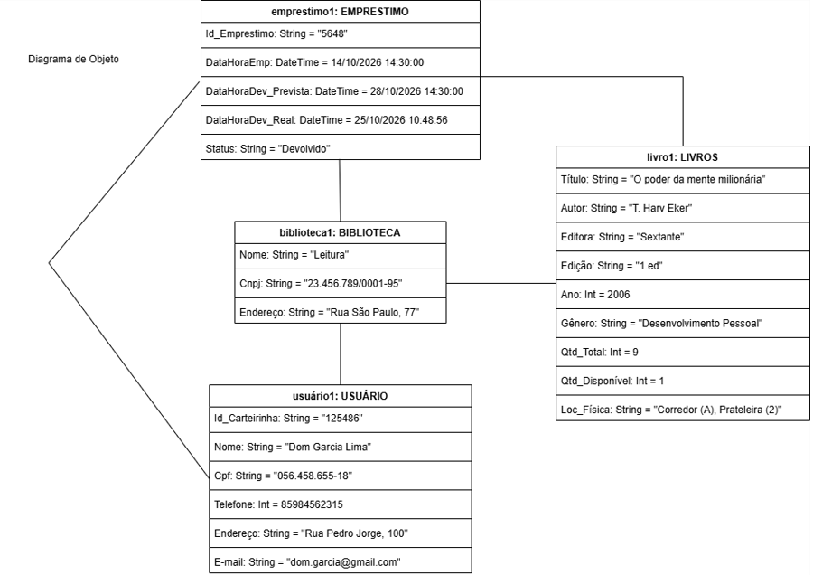
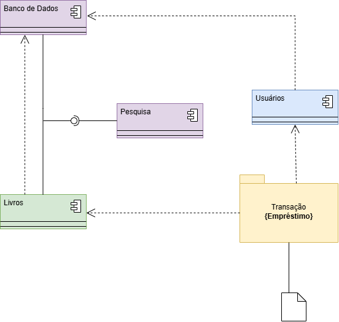

# 🚀 Visão do Produto e Personas

## 1. Declaração do Problema:

| Problema | Afetados | Impacto | Solução |
| :--- | :--- | :--- | :--- |
| Processos manuais e um sistema legado obsoleto | Bibliotecários (funcionários) | Lentidão no atendimento, erros no controle de estoque de livros, perda de prazos de devolução e dificuldades na localização de obras | Sistema moderno de gerenciamento que automatiza empréstimos/devoluções com código de barras, atualiza o estoque em tempo real e forneça métricas operacionais |
| Falta de acesso remoto ao acervo | Usuários (leitores e frequentadores) | Deslocamentos desnecessários até a biblioteca sem a garantia de disponibilidade da obra desejada | Um catálogo online acessível via web, permitindo consultas prévias por título, autor, categoria, status e localização exata (corredor/prateleira) |

---
## 2. Objetivos do Produto

* **Geral:**
  * Modernizar e automatizar a gestão operacional da Biblioteca sem interromper os atendimentos presenciais em andamento.
* **Objetivos Específicos:**
  * Reduzir o tempo de registro de empréstimos e devoluções através de leitores de código de barras vinculados às carteirinhas dos usuários.
  * Disponibilizar um catálogo online amigável para pesquisa pública de acervo e localização física (corredor e prateleira).
  * Automatizar regras complexas de circulação (prazos, renovações, reservas e penalidades por atraso).
  * Gerar relatórios estatísticos para apoiar a gestão municipal em decisões de aquisição e reposição de livros.

 
 ### 2.1 Fora do Escopo (Fase 1)
- Venda ou e-commerce de livros físicos/digitais.
- Empréstimo de e-books / acervo digital (DRM).
- Integração com redes de bibliotecas de outros municípios nesta versão inicial.

---

## 3. Mapeamento de Personas

### Persona 1: O Operador do Sistema
* **Nome:** Maria Clara (42 anos)
* **Função:** Bibliotecária Chefe
* **Necessidades:**
  * Agilidade para registrar empréstimos e devoluções no balcão de atendimento via leitura ótica.
  * Controle rigoroso sobre quem está com cada livro e datas de vencimento.
  * Relatórios simples para apresentar à gestão municipal sobre os livros mais populares.
- **Dores:**
* **Dores:**
  * Sistema atual é lento, trava com frequência e exige digitação manual prolongada.
  * Frequentes inconsistências entre a quantidade de livros no sistema e na estante.

---

### Persona 2: O Usuário Final / Leitor
* **Nome:** Lucas Andrade (21 anos)
* **Função:** Estudante Universitário / Frequentador da Biblioteca
* **Necessidades:**
  * Consultar pela internet se um livro específico está disponível e em qual prateleira ele se encontra antes de ir até a biblioteca.
  * Visualizar sinopse, foto da capa e detalhes técnicos da obra.
  * Receber lembretes antes do prazo de devolução vencer para evitar bloqueios.
* **Dores:**
  * Perder tempo indo até a biblioteca física para descobrir que o livro desejado já foi emprestado.
  * Esquecer a data de devolução por falta de aviso preventivo e acabar bloqueado.

---

## 4. Escopo Visual: Diagramas  (UML)

Os diagramas a seguir apresentam as diferentes visões de modelagem do Sistema de Gerenciamento de Biblioteca, abrangendo os aspectos comportamentais (Casos de Uso) e estruturais (Classes, Objetos e Componentes):

### Diagrama de Caso de Uso 
Para visualizar as interações entre os atores (Usuário e Bibliotecário) e o escopo do sistema, confira o diagrama abaixo:

### Diagrama de Classe 
Para visualizar a estrutura estática do sistema, representando as classes, suas características e como elas se relacionam, confira o diagrama abaixo:

### Diagrama de Objetos 
Para visualizar o momento específico de execução do sistema, mostrando instâncias reais de classes e as ligações entre elas com dados e valores concretos, confira o diagrama abaixo:

### Diagrama de Componentes 
Para visualizar a estrutura física e a organização do sistema, mostrando como diferentes partes (componentes) se conectam e dependem umas das outras, confira o diagrama abaixo:

---

## 5. Modelagem de Processos de Negócio (BPMN)

Como parte da evolução da engenharia de processos do sistema, esta etapa encontra-se **em andamento**. 

- **Fase Atual — Priorização Estratégica:** Concluímos a etapa de levantamento e priorização utilizando a **Matriz Trade-Off** com os stakeholders, onde definimos que o foco principal do redesenho será a **Agilidade no atendimento** e a **Qualidade**.
- **Próximos Passos (AS-IS e TO-BE):** A partir das diretrizes da matriz trade-off, iniciamos a modelagem dos fluxos operacionais para mapear o processo atual (**AS-IS**) e desenhar o fluxo otimizado (**TO-BE**) em BPMN, detalhando as interações entre o Leitor, o Bibliotecário e o SGB. *(em desenvolvimento)*
